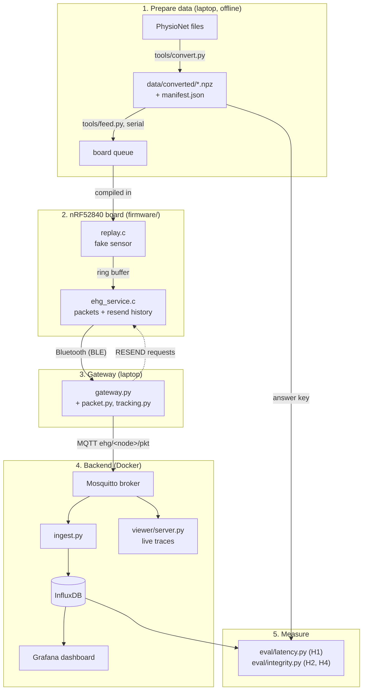

# Codebase guide: how the EHG pipeline fits together

This is a plain-language map of the code. Every code file also starts with a short header covering
**Purpose / Input / Output / How / Role in thesis / Before → After**, and each function has a one-line note. Read this guide
first for the big picture, then open any file.

## Other docs

| Doc | Read it for |
|---|---|
| [README.md](../README.md) | setup + the commands to run everything |
| [data/tpehgdb.md](data/tpehgdb.md), [tpehgt](data/tpehgt.md), [ehgdb](data/ehgdb.md), [icehg](data/icehg.md) | what is inside the data folders (`.hea`, `.dat`, `.npz`, `manifest.json`), with example records |
| [firmware.md](firmware.md) | the board's code: role of each file, threads, settings, serial log, `build/` output, glossary |
| [interface-spec.md](interface-spec.md) | exact formats: `.npz`, packet bytes, MQTT message, database schema, FHIR export |
| [research/nrf-ble-environment.md](research/nrf-ble-environment.md) | nRF / Bluetooth / macOS setup notes with sources |
| [progress.md](progress.md) | status log, blockers, next steps |
| [design/codebase-design.md](design/codebase-design.md) | design notes behind this layout |
| [../papers/INDEX.md](../papers/INDEX.md) | the papers cited in the report |

## The one-sentence version

A real pregnancy EHG recording is played back by a small board as if it were a live sensor, sent over
Bluetooth to a laptop, then passed on to a database and dashboards. Every sample carries a number and a timestamp,
so we can measure **how fast** it arrived (H1), **whether** it arrived (H2), and **whether it is unchanged** (H4).

## The journey of one sample

Step by step:

1. **Prepare the data** ([`tools/convert.py`](../tools/convert.py)). Turns downloaded recordings into simple `.npz` files of untouched
   whole numbers, plus a `manifest.json` that gives each recording a number (`record_id`).
2. **Stream one recording into the board** ([`tools/feed.py`](../tools/feed.py)). Sends the samples over the serial port a
   couple of seconds ahead; the firmware is built once ([`firmware/build.sh`](../firmware/build.sh)) and never contains a recording.
3. **Play it like a sensor** ([`firmware/ehg_node/src/replay.c`](../firmware/ehg_node/src/replay.c)). Releases one frame at a time at the original rate
   (for example 20 per second) and stamps each frame with the board's clock. A *frame* is one sample from every channel at one instant.
4. **Pack and send** ([`firmware/ehg_node/src/ehg_service.c`](../firmware/ehg_node/src/ehg_service.c)). Groups 10 frames into one numbered packet,
   keeps a copy, and sends the packet over Bluetooth. If the laptop says a packet went missing, it sends the copy again.
   [`main.c`](../firmware/ehg_node/src/main.c) handles start-up and making the Bluetooth connection.
5. **Receive on the laptop** ([`gateway/gateway.py`](../gateway/gateway.py)). Decodes each packet ([`packet.py`](../gateway/packet.py)) and spots missing
   packet numbers ([`tracking.py`](../gateway/tracking.py)), then asks for those again. It converts the board's clock to real time and publishes the
   packet as a JSON message over MQTT. `--simulate` runs the same steps with no board.
6. **Store** ([`backend/ingest/ingest.py`](../backend/ingest/ingest.py)). Writes each frame to InfluxDB and records the time the
   database confirmed the write. That confirmation is the finish line for latency.
7. **Look at it**: the Grafana dashboard (overview, latency, packet rate) and [`viewer/`](../viewer) (live raw waves).
8. **Measure**: [`eval/latency.py`](../eval/latency.py) (H1) and [`eval/integrity.py`](../eval/integrity.py) (H2 and bit-exact H4). Both read the database
   through [`eval/backend_client.py`](../eval/backend_client.py) and compare against the files from step 1.
9. **Hand off** ([`tools/fhir_export.py`](../tools/fhir_export.py)): a stored window as an HL7 FHIR R5 Bundle (raw counts + mV scaling) for clinical systems.

## Where each hypothesis lives

| Hypothesis | What it asks | Produced by | Measured by |
|---|---|---|---|
| H1 latency | 95 % of samples stored within 2 s (stretch: 1 s) | timestamps at [`replay.c`](../firmware/ehg_node/src/replay.c) → [`gateway.py`](../gateway/gateway.py) → [`ingest.py`](../backend/ingest/ingest.py) | [`eval/latency.py`](../eval/latency.py) |
| H2 delivery | more than 99 % arrive, and every loss can be identified | packet numbers + history/resend in [`ehg_service.c`](../firmware/ehg_node/src/ehg_service.c), gap tracking in [`tracking.py`](../gateway/tracking.py), broker queue | [`eval/integrity.py`](../eval/integrity.py) |
| H3 many nodes | at least 8 boards at once | unique names ([`main.c`](../firmware/ehg_node/src/main.c)), `--nodes N` / `--simulate N` ([`gateway.py`](../gateway/gateway.py)) | gateway stats (needs more hardware) |
| H4 fidelity | stored numbers identical to the source | raw numbers end to end ([`convert.py`](../tools/convert.py) → … → [`ingest.py`](../backend/ingest/ingest.py)) | [`eval/integrity.py`](../eval/integrity.py) (mismatches) |

## Timestamps along the way (H1)

| Name | Taken where | Meaning |
|---|---|---|
| `t_inject` | [`replay.c`](../firmware/ehg_node/src/replay.c) | board clock tick when the packet's first frame was "sampled" |
| `t_inject_host` | [`gateway.py`](../gateway/gateway.py) (via [`tracking.py:ClockMap`](../gateway/tracking.py)) | the same moment, converted to laptop time |
| `t_gw_rx` | [`gateway.py`](../gateway/gateway.py) | packet arrived at the laptop |
| `t_mqtt_pub` | [`gateway.py`](../gateway/gateway.py) | packet handed to the MQTT broker |
| `t_ingest_rx` | [`ingest.py`](../backend/ingest/ingest.py) | ingest service received it |
| `t_db_ack` | [`ingest.py`](../backend/ingest/ingest.py) | database confirmed the samples are stored (finish line) |

## File index

| File | One-line role |
|---|---|
| [`tools/convert.py`](../tools/convert.py) | downloaded recordings → `.npz` + `manifest.json` (the answer key) |
| [`tools/feed.py`](../tools/feed.py) | streams one `.npz` into the board over the serial port (digital injection) |
| [`tools/fhir_export.py`](../tools/fhir_export.py) | stored window → HL7 FHIR R5 Bundle (clinical hand-off) |
| [`firmware/build.sh`](../firmware/build.sh) | build and flash the board (works around spaces in this folder's path). Overview of all firmware: [firmware.md](firmware.md) |
| [`firmware/ehg_node/CMakeLists.txt`](../firmware/ehg_node/CMakeLists.txt) | which C files to compile |
| [`firmware/ehg_node/Kconfig`](../firmware/ehg_node/Kconfig) | our tunable settings (frames per packet, buffer sizes) |
| [`firmware/ehg_node/prj.conf`](../firmware/ehg_node/prj.conf) | Bluetooth and logging settings |
| [`firmware/ehg_node/src/main.c`](../firmware/ehg_node/src/main.c) | start-up, advertising, connection events, stats every 10 s |
| `firmware/ehg_node/src/replay.c/.h` | fake sensor: timed frame release into the ring buffer |
| `firmware/ehg_node/src/ehg_service.c/.h` | Bluetooth service, packet building, history, resend |
| [`firmware/ehg_node/src/ehg_packet.h`](../firmware/ehg_node/src/ehg_packet.h) | packet byte layout (copy 1 of 2) |
| [`gateway/packet.py`](../gateway/packet.py) | packet byte layout (copy 2 of 2) |
| [`gateway/tracking.py`](../gateway/tracking.py) | missing-packet tracker and clock converter |
| [`gateway/gateway.py`](../gateway/gateway.py) | Bluetooth (or simulated) → MQTT bridge |
| [`backend/docker-compose.yml`](../backend/docker-compose.yml) | starts broker, database, ingest and Grafana |
| [`backend/.env.example`](../backend/.env.example) | shared names and passwords (copy to `.env`) |
| [`backend/mosquitto/mosquitto.conf`](../backend/mosquitto/mosquitto.conf) | broker settings (keeps a queue on disk) |
| [`backend/ingest/ingest.py`](../backend/ingest/ingest.py) + `Dockerfile` | MQTT → InfluxDB writer |
| `backend/grafana/provisioning/*.yml` | auto-connect Grafana to InfluxDB and load the dashboard |
| [`backend/grafana/dashboards/ehg-overview.json`](../backend/grafana/dashboards/ehg-overview.json) | the dashboard (see below) |
| [`viewer/server.py`](../viewer/server.py) + [`index.html`](../viewer/index.html) | live raw-wave page |
| [`eval/backend_client.py`](../eval/backend_client.py) | shared database queries |
| [`eval/latency.py`](../eval/latency.py) | H1 numbers and CDF plot |
| [`eval/integrity.py`](../eval/integrity.py) | H2 delivery and H4 bit-exact numbers |
| `tests/*.py` | automatic checks for the pure-logic parts (`uv run pytest -q`) |

## The Grafana dashboard ([`ehg-overview.json`](../backend/grafana/dashboards/ehg-overview.json))

JSON files can't hold comments, so here is what the dashboard contains. A **node** drop-down at the top picks which boards to show. It has four panels:

1. **Raw EHG (ADC units)**: the stored samples (`ehg_raw`, fields `c0…cN`), one line per channel.
2. **End-to-end latency per packet**: `t_db_ack − t_inject_host` for each non-resent packet. This is a quick live
   view of H1; [`eval/latency.py`](../eval/latency.py) gives the corrected numbers.
3. **Packets per second**: should stay flat at 2/s for TPEHG (20 Hz ÷ 10 frames). Dips mean loss or stalls.
4. **Retransmitted packets per minute**: how often loss recovery is working (H2).

## The two copies of the packet format

[`firmware/ehg_node/src/ehg_packet.h`](../firmware/ehg_node/src/ehg_packet.h) (C, on the board) and [`gateway/packet.py`](../gateway/packet.py) (Python, on the laptop) describe the
same 20-byte header. If one changes, change the other and [`docs/interface-spec.md`](interface-spec.md) with it. [`tests/test_packet.py`](../tests/test_packet.py)
checks that the Python side is self-consistent, and the C side checks its size at build time.

## Glossary

- **ADC units**: the raw whole numbers a sensor's analogue-to-digital converter produces. To get millivolts,
  compute (value − baseline) ÷ gain. We keep the raw numbers so we can compare them exactly.
- **BLE (Bluetooth Low Energy)**: the low-power radio link between board and laptop.
- **GATT service / characteristic**: Bluetooth's way of naming data slots on a device. Ours has a "data" slot that the board
  pushes to (*notify*) and a "control" slot that the laptop writes commands to.
- **MTU**: the largest single message the Bluetooth link allows. It caps how many frames fit in one packet.
- **Firmware**: the program that runs on the board. **Zephyr / NCS** is the small operating system and Nordic's toolkit for it.
- **Ring buffer**: a fixed-size waiting queue. When it is full, new items are counted as dropped, never hidden.
- **seq**: packet number. Gaps in seq mean lost packets.
- **frame_idx**: frame number. It maps straight back to a row in the source recording.
- **Tick**: one beat of the board's clock (32 768 per second).
- **MQTT / broker / topic / QoS 1**: a publish-subscribe "post office". The broker (Mosquitto) passes messages on
  a topic to everyone subscribed. QoS 1 retries until delivery is confirmed, so a message may arrive twice, and
  ingest removes the duplicates.
- **InfluxDB / Flux**: a database built for time-stamped data, and its query language.
- **Docker container**: a packaged, isolated program. `docker compose` starts several of them together.
- **CDF**: a curve showing what fraction of samples arrived within a given time.
- **Digital injection**: feeding stored data into the board in software (no analogue circuit), so the "right
  answer" is known exactly.
