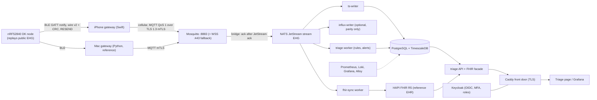

# Production topology: from prototype to an enterprise-style remote-monitoring chain

**Status of this document (2026-11-03):** a plan. At the time of writing only the *Existing* items below are built. Every other row says *Planned*
(with the unit that builds it) or *Design-only* (never to be built on free services). Statuses are updated as each unit lands and again in Unit 17.
Why each choice was made: [decisions 0007 to 0017](decisions/0007-enterprise-evolution-keep-influx-as-reference.md). The wire format, MQTT JSON and database schema are in
[interface-spec.md](interface-spec.md); the code is mapped in [codebase-guide.md](codebase-guide.md).

**Intended purpose.** Research prototype for measuring wireless telemetry performance. Not for clinical decision-making. Not supplied to any person for patient care.
Makes no diagnostic or predictive claims.

The validated results H1 to H4 were measured on the prototype topology and are never rewritten ([decision 0007](decisions/0007-enterprise-evolution-keep-influx-as-reference.md)).
The default local experience (`cd backend && docker compose up -d`, `python -m gateway.gateway`) does not change; every new capability is behind a flag, a compose profile or an override file.

## Target architecture

All cloud services run on one Oracle Always Free VM ([decision 0010](decisions/0010-oracle-always-free-cloud-target.md)). A C4-style context and container pair is added in Unit 17.

## Four tiers: today and target

| Tier | Today (built) | Target | Units |
|---|---|---|---|
| 1 Sensor node | nRF52840 DK, Zephyr; replays public EHG; BLE GATT notify; MCUboot with Nordic's development key | Same, plus optional LESC passkey pairing and our own signing key | 13 |
| 2 Gateways | `gateway/gateway.py`: Bleak, CRC, gap tracker, RESEND, clock map, in-memory MQTT queue | Python gateway with mTLS and a durable outbox; native iOS gateway with the same behaviour | 2, 3, 15 |
| 3 Cloud core | Mosquitto (anonymous, port 1883), `backend/ingest/ingest.py`, InfluxDB 2.7, Grafana | mTLS Mosquitto with ACLs, NATS JetStream, TimescaleDB, registry and certificate enrolment, Keycloak, triage service, HAPI FHIR, observability, infrastructure as code, backups | 4 to 12 |
| 4 Operator UI | Grafana and `viewer/` raw traces | Triage page (pipeline-health worklist, sparklines, alert workflow, FHIR panel) behind Keycloak sign-in | 10, 11 |

## Data-flow boundaries

| Boundary | Protocol | Authentication | Confidentiality | Failure behaviour |
|---|---|---|---|---|
| Node to gateway | BLE GATT notify, wire v2 with CRC-16, RESEND | Optional LESC passkey bond (Unit 13) | Optional link-layer AES-CCM | Board keeps 256 packets; gaps re-asked up to 5 times |
| Gateway to broker | MQTT QoS 1 JSON on `ehg/<node>/pkt` | mTLS client certificate (CN = gateway id, 7-day, from enrolment) | TLS 1.3 or later on 8883; WSS on 443 as fallback | Durable outbox; backoff 1 s to 60 s with jitter |
| Broker to bus | MQTT QoS 1 persistent session into JetStream | mTLS (service identity) | Docker network and TLS | Bridge acknowledges only after the JetStream ack |
| Bus to stores and services | JetStream durable pull consumers, explicit ack | NATS credentials | Docker-internal | Redelivery; writes idempotent on `(node, seq, t_inject)` |
| Services to Postgres and HAPI | SQL; FHIR REST | Database roles; OAuth2 client-credentials tokens | Docker-internal | Degrade visibly, never silently |
| Browser or iPhone to UI and API | HTTPS through Caddy | Keycloak OIDC (PKCE, TOTP for operator and admin) | Let's Encrypt certificate | Read-only for the `viewer` role |

## The six-hop chain, and what each hop really is

Never describe a stand-in or design-only hop as if it were done.

| # | Production hop | Realised as | Status |
|---|---|---|---|
| 1 | Sensor node | nRF52840 **DK** replaying public EHG. Not a wearable and no analogue front end (that is another thesis's scope) | Existing; pairing and signing key Planned (Unit 13) |
| 2 | BLE link | Zephyr GATT notify, wire v2 with CRC and RESEND | Existing; LESC option Planned (Unit 13) |
| 3 | Mobile gateway | Native Swift iOS app, with the Python gateway as reference | Planned (Unit 15); gated by a feasibility spike; free signing expires every 7 days |
| 4 | Cellular and MQTT | iPhone cellular data; MQTT over TLS 1.3 mTLS (or WSS on 443) | Planned; will be a *phone-cellular* measurement (H1-cellular). A real LTE-M or NB-IoT modem is **Design-only / not built** |
| 5 | Cloud core | Oracle A1 VM: Mosquitto, NATS, TimescaleDB, triage, HAPI, Keycloak, observability | Planned (Units 4 to 12); needs your Oracle account |
| 6a | Operator dashboard | Triage page, Grafana and the raw viewer | Grafana and the viewer Existing; triage page Planned (Unit 10) |
| 6b | EHR interoperability | Self-hosted HAPI FHIR R5 as a *reference* EHR | Sync worker and read-only facade written and tested against a fake FHIR server (Unit 9); HAPI itself never started; no hospital EHR, HL7 v2 or vendor integration |

**Design-only (written up, never built):** multi-zone or multi-region availability and broker clustering; restoring onto an Azure free VM; a real LTE-M or NB-IoT modem;
App Store or TestFlight distribution; fleet-wide staged firmware rollout; write-once audit storage; AU Core conformance.

## Prototype versus enterprise reference, mapped to this repository

| Dimension | Prototype today | Enterprise reference | After this work | Status |
|---|---|---|---|---|
| Objective | Measure latency, delivery and fidelity of an EHG telemetry chain | Scalable remote patient care | Same objective; production layers added as measured, optional profiles | Existing / Planned |
| Data path | Replay, DK, BLE, Bleak laptop gateway, MQTT, ingest, InfluxDB, Grafana and viewer | Sensor, BLE, mobile gateway, cellular and MQTT, cloud, EHR and dashboard | Same path with an iOS gateway on cellular, mTLS MQTT, JetStream, TimescaleDB, HAPI FHIR, triage page | Planned |
| Coverage | BLE about 10 m; gateway on a laptop | Cellular or Wi-Fi wide area | iPhone cellular to the Oracle VM over the internet | Planned (modem Design-only) |
| Resilience | 256-packet board history and RESEND; in-memory MQTT queue; persistent broker session | Persistent store and forward, high availability | Durable outbox (Python and iOS), JetStream redelivery, idempotent writes, backups and a restore drill | Planned (high availability Design-only) |
| Ingestion | Mosquitto anonymous on 1883 | Clustered broker with mTLS | mTLS on 8883 with ACLs, short-lived certificates and a CRL | Planned (clustering Design-only) |
| Storage | InfluxDB 2.7 | TimescaleDB plus relational | TimescaleDB and Postgres (registry, alerts, audit) with parity to InfluxDB; Influx stays the reference | Planned |
| Identity and security | CRC only; Nordic development bootloader key | LESC, mTLS 1.3, X.509, OIDC, role-based access, write-once audit | LESC (flag), mTLS 1.3, certificate lifecycle, Keycloak with MFA and roles, hash-chained audit | Planned (write-once Design-only) |
| EHR | FHIR R5 batch export only (`tools/fhir_export.py`) | FHIR write-back to the EHR | Live write-back into a self-hosted HAPI FHIR R5 server | Existing (export) / Planned |
| Operator UI | Grafana and raw viewer | Severity worklist, sparklines, alert workflow, EHR panel | Triage page for pipeline health with a HAPI-backed EHR panel | Planned |
| Operations | Manual `docker compose` on a Mac | Infrastructure as code, observability, disaster recovery, SLOs | Terraform and cloud-init, Prometheus and Loki stack, SLOs, measured RPO and RTO | Planned |
| Compliance | Unregulated prototype | Software-as-medical-device obligations, health privacy law | Intended-purpose statement; Australian framing; standards "designed with reference to"; no compliance claims | Planned (Unit 17) |

## Enterprise capability checklist

| Capability | Free implementation | Status | Units |
|---|---|---|---|
| Device registry and provisioning | Postgres `registry` schema, enrolment API, step-ca | Planned | 6, 7 |
| Gateway identity and revocation | 7-day client certificates, CRL | Planned (CRL reload unverified) | 2, 7 |
| Over-the-air update | MCUboot and MCUmgr exist; own signing key; app-based update | Partly Existing; key Planned; app update Tier C; fleet rollout Design-only | 13, 15d |
| Multi-subject data model | Pseudonymous `subject` per PhysioNet record | Planned | 6, 7 |
| Consent | FHIR `Consent`, enforced in the facade | Planned (a data-model demonstration, not a legal consent platform) | 9 |
| Audit | Hash-chained log, FHIR `AuditEvent`, Loki | Planned (tamper-evident, **not** write-once) | 8, 9 |
| Alert management | Rules, hysteresis, lifecycle with required notes | Planned | 8, 10 |
| High availability | None on one free VM | **Design-only** | 12 |
| Disaster recovery | pgBackRest, restic, a timed restore drill | Planned; RPO about 24 h; RTO to be measured | 12 |
| Observability | Prometheus, Alertmanager, Loki, Grafana, Alloy, OCI alarm | Planned | 12 |
| Service-level objectives | Prometheus recording rules; measured, no SLA | Planned | 12 |
| Infrastructure as code | Terraform, cloud-init, Docker Compose | **Written and validated (`terraform validate`), never applied** (Unit 4); the compose file is partial until Units 6 to 9 | 4 |
| Supply chain | Syft, Trivy, cosign, Dependabot, gitleaks | Planned | 14 |
| Regulatory pack | Intended purpose, hazard analysis, traceability | Planned; "designed with reference to" only | 17 |

Licences for every component: [licences.md](licences.md).
