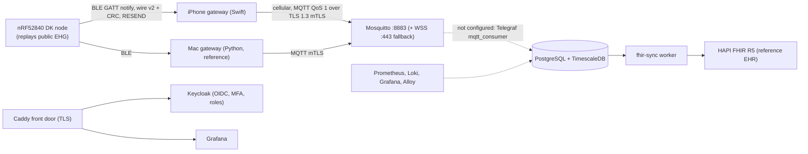
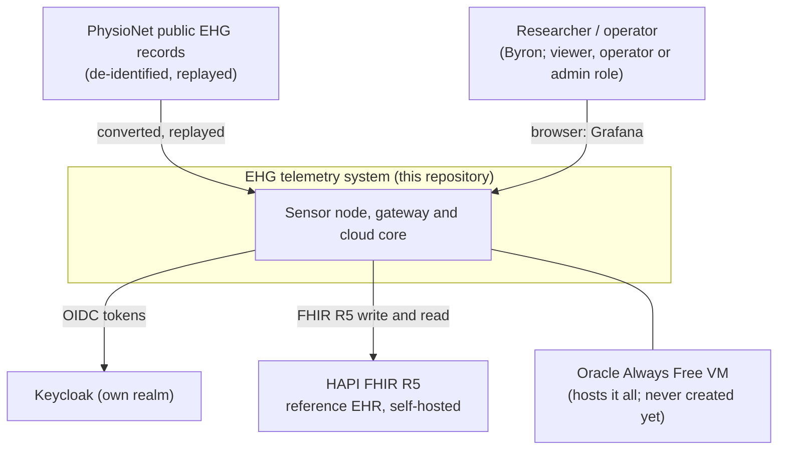
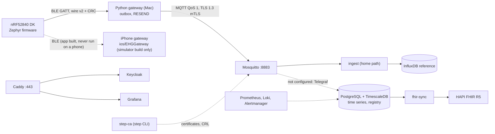

# Production topology: from prototype to an enterprise-style remote-monitoring chain

**Trimmed 11 Nov 2026.** The triage service and page, enrolment API, MQTT-to-NATS bridge, TimescaleDB writer, NATS and the MQTT exporter were removed in favour of standard tools ([reuse ledger](licences.md#reuse-ledger)). The cloud design below now has an unfilled step between the broker and TimescaleDB.

**Status of this document (2026-11-04, final pass of the non-cloud sweep):** the *Existing* items were built and measured on the prototype. Rows marked **Written** have code and unit tests but **have never run as a service** (no Docker and no cloud account were available): they are not validated results.
Rows marked *Planned* are not built (they need the board, the iPhone or the VM). *Design-only* is never to be built on free services. Statuses were updated in Unit 17.
Why each choice was made: [decisions 0007 to 0017](decisions/0007-enterprise-evolution-keep-influx-as-reference.md). The wire format, MQTT JSON and database schema are in
[interface-spec.md](interface-spec.md); the code is mapped in [codebase-guide.md](codebase-guide.md).

**Intended purpose.** Research prototype for measuring wireless telemetry performance. Not for clinical decision-making. Not supplied to any person for patient care.
Makes no diagnostic or predictive claims.

The validated results H1 to H4 were measured on the prototype topology and are never rewritten ([decision 0007](decisions/0007-enterprise-evolution-keep-influx-as-reference.md)).
The default local experience (`cd backend && docker compose up -d`, `python -m gateway.gateway`) does not change; every new capability is behind a flag, a compose profile or an override file.

## Target architecture

All cloud services run on one Oracle Always Free VM ([decision 0010](decisions/0010-oracle-always-free-cloud-target.md)). A C4-style context and container pair is added in Unit 17.

## Four tiers: today and target

| Tier | Today (built) | Target | Units |
|---|---|---|---|
| 1 Sensor node | nRF52840 DK, Zephyr; replays public EHG; BLE GATT notify; MCUboot with Nordic's development key | Same, plus optional LESC passkey pairing and our own signing key | 13 |
| 2 Gateways | `gateway/gateway.py`: Bleak, CRC, gap tracker, RESEND, clock map, in-memory MQTT queue | Python gateway with mTLS and a durable outbox; native iOS gateway with the same behaviour | 2, 3, 15 |
| 3 Cloud core | Mosquitto (anonymous, port 1883), `backend/ingest/ingest.py`, InfluxDB 2.7, Grafana | mTLS Mosquitto with ACLs, TimescaleDB, Keycloak, HAPI FHIR, observability, infrastructure as code, backups | 4 to 12 |
| 4 Operator UI | Grafana and `viewer/` raw traces | Grafana behind Caddy with its own login | 12 |

## Data-flow boundaries

| Boundary | Protocol | Authentication | Confidentiality | Failure behaviour |
|---|---|---|---|---|
| Node to gateway | BLE GATT notify, wire v2 with CRC-16, RESEND | Optional LESC passkey bond (Unit 13) | Optional link-layer AES-CCM | Board keeps 256 packets; gaps re-asked up to 5 times |
| Gateway to broker | MQTT QoS 1 JSON on `ehg/<node>/pkt` | mTLS client certificate (CN = gateway id, 7-day, from the `step` CLI) | TLS 1.3 or later on 8883; WSS on 443 as fallback | Durable outbox; backoff 1 s to 60 s with jitter |
| Broker to database | Not configured since 11 Nov 2026 (Telegraf `mqtt_consumer` is the standard tool) | | | |
| Services to Postgres and HAPI | SQL; FHIR REST | Database roles; OAuth2 client-credentials tokens | Docker-internal | Degrade visibly, never silently |
| Browser or iPhone to UI and API | HTTPS through Caddy | Keycloak OIDC (PKCE, TOTP for operator and admin) | Let's Encrypt certificate | Read-only for the `viewer` role |

## The six-hop chain, and what each hop really is

Never describe a stand-in or design-only hop as if it were done.

| # | Production hop | Realised as | Status |
|---|---|---|---|
| 1 | Sensor node | nRF52840 **DK** replaying public EHG. Not a wearable and no analogue front end (that is another thesis's scope) | Existing; pairing and signing key Planned (Unit 13) |
| 2 | BLE link | Zephyr GATT notify, wire v2 with CRC and RESEND | Existing; LESC option Planned (Unit 13) |
| 3 | Mobile gateway | Native Swift iOS app, with the Python gateway as reference | Wire library **written and tested on the Mac** (`ios/EHGWire`); the app, the feasibility spike and any phone test are Planned (need Byron and the phone); free signing expires every 7 days |
| 4 | Cellular and MQTT | iPhone cellular data; MQTT over TLS 1.3 mTLS (or WSS on 443) | Planned; will be a *phone-cellular* measurement (H1-cellular). A real LTE-M or NB-IoT modem is **Design-only / not built** |
| 5 | Cloud core | Oracle A1 VM: Mosquitto, TimescaleDB, HAPI, Keycloak, observability | **Written** (Terraform validated); never applied or started; needs your Oracle account |
| 6a | Operator dashboard | Grafana and the raw viewer | Existing |
| 6b | EHR interoperability | Self-hosted HAPI FHIR R5 as a *reference* EHR | Sync worker and read-only facade written and tested against a fake FHIR server (Unit 9); HAPI itself never started; no hospital EHR, HL7 v2 or vendor integration |

**Design-only (written up, never built):** multi-zone or multi-region availability and broker clustering; restoring onto an Azure free VM; a real LTE-M or NB-IoT modem;
App Store or TestFlight distribution; fleet-wide staged firmware rollout; write-once audit storage; AU Core conformance.

**Interoperability future work (not built):** the node uses a custom GATT service. The standards route is the Bluetooth Generic Health Sensor profile (GHS, IEEE 11073-10206), which would let a standard health gateway read the node without this repository's gateway.

**Build versus reuse:** the *Written* rows are a design artefact and future work, not results. Where an existing tool could replace custom code, the [reuse ledger](licences.md#reuse-ledger) names it.

## Prototype versus enterprise reference, mapped to this repository

| Dimension | Prototype today | Enterprise reference | After this work | Status |
|---|---|---|---|---|
| Objective | Measure latency, delivery and fidelity of an EHG telemetry chain | Scalable remote patient care | Same objective; production layers added as measured, optional profiles | Existing / Planned |
| Data path | Replay, DK, BLE, Bleak laptop gateway, MQTT, ingest, InfluxDB, Grafana and viewer | Sensor, BLE, mobile gateway, cellular and MQTT, cloud, EHR and dashboard | Same path with an iOS gateway on cellular, mTLS MQTT, TimescaleDB, HAPI FHIR, Grafana | Planned |
| Coverage | BLE about 10 m; gateway on a laptop | Cellular or Wi-Fi wide area | iPhone cellular to the Oracle VM over the internet | Planned (modem Design-only) |
| Resilience | 256-packet board history and RESEND; in-memory MQTT queue; persistent broker session | Persistent store and forward, high availability | Durable outbox (Python and iOS), backups and a restore drill | Planned (high availability Design-only) |
| Ingestion | Mosquitto anonymous on 1883 | Clustered broker with mTLS | mTLS on 8883 with ACLs, short-lived certificates and a CRL | Planned (clustering Design-only) |
| Storage | InfluxDB 2.7 | TimescaleDB plus relational | TimescaleDB and Postgres (registry); Influx stays the reference | Planned |
| Identity and security | CRC only; Nordic development bootloader key | LESC, mTLS 1.3, X.509, OIDC, role-based access, write-once audit | LESC (flag), mTLS 1.3, certificate lifecycle, Keycloak with MFA and roles, hash-chained audit | Planned (write-once Design-only) |
| EHR | FHIR R5 batch export only (`tools/fhir_export.py`) | FHIR write-back to the EHR | Live write-back into a self-hosted HAPI FHIR R5 server | Existing (export) / Written (live write-back, fake server only) |
| Operator UI | Grafana and raw viewer | Severity worklist, sparklines, alert workflow, EHR panel | Grafana for pipeline health; the custom triage page was removed 11 Nov 2026 | Existing |
| Operations | Manual `docker compose` on a Mac | Infrastructure as code, observability, disaster recovery, SLOs | Terraform and cloud-init, Prometheus and Loki stack, SLOs, RPO declared, RTO to be measured | Written (never applied) |
| Compliance | Unregulated prototype | Software-as-medical-device obligations, health privacy law | Intended-purpose statement; Australian framing; standards "designed with reference to"; no compliance claims | Written ([regulatory.md](regulatory.md)) |

## Enterprise capability checklist

| Capability | Free implementation | Status | Units |
|---|---|---|---|
| Device registry and provisioning | Postgres `registry` schema, step-ca with the `step` CLI | Schema **Written**; step-ca never run | 6 |
| Gateway identity and revocation | 7-day client certificates, CRL | **Written**; CRL reload tested on a local Mosquitto 2.1.2; the CRL reaches the broker by a manual copy | 2, 7 |
| Over-the-air update | MCUboot and MCUmgr exist; own signing key; app-based update | Configured, not validated: the bootloader and update service are built in, but no over-the-air upload has been performed; key Planned; app update Tier C; fleet rollout Design-only | 13, 15d |
| Multi-subject data model | Pseudonymous `subject` per PhysioNet record | **Written** (registry tables), tested | 6, 7 |
| Consent | Registry consent status, enforced in the sync worker (no FHIR `Consent` resource is written) | **Written**, tested (a data-model demonstration, not a legal consent platform) | 8, 9 |
| Audit | Loki logs only; the hash-chained log was removed with the triage service | Not built | |
| Alert management | Grafana alert rules and Alertmanager | **Run** on the home path (one rule seen firing); no custom lifecycle since 11 Nov 2026 | 12 |
| High availability | None on one free VM | **Design-only** | 12 |
| Disaster recovery | Nightly `pg_dump`, optional restic, a timed restore drill (pgBackRest and point-in-time recovery NOT built) | **Written**; restore tested on a throwaway PostgreSQL; RPO about 24 h; RTO not measured | 12 |
| Observability | Prometheus, Alertmanager, Loki, Grafana, Alloy, OCI alarm | **Written** (rules and dashboard structure-tested; never evaluated; alert delivery not wired) | 12 |
| Service-level objectives | Prometheus recording rules; measured, no SLA | **Written**; no value measured yet ([slo.md](slo.md)) | 12 |
| Infrastructure as code | Terraform, cloud-init, Docker Compose | **Written and validated (`terraform validate`), never applied** (Unit 4); the compose file is partial until Units 6 to 9 | 4 |
| Supply chain | Syft, Trivy, cosign, Dependabot, gitleaks | Minimal: shellcheck and guard tests in CI, Dependabot; scanners documented, not wired ([supply-chain.md](supply-chain.md)) | 14 |
| Regulatory pack | Intended purpose, hazard analysis, traceability | **Written** ([regulatory.md](regulatory.md)); "designed with reference to" only | 17 |

Licences for every component: [licences.md](licences.md).

## C4-style views (Mermaid)

**Context: who and what the system talks to.** There is no hospital system, no patient and no clinician in the loop: the "reference EHR" is a self-hosted FHIR server.

**Containers: the pieces and the protocols between them.** Solid boxes exist as code; none of the cloud containers has been started.

